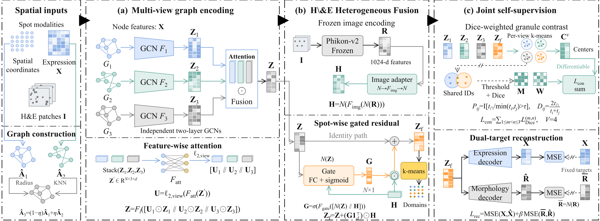

# SpaDGCC

**Spatial Domain Clustering with Gated Image Fusion and Granular-ball Contrastive Learning**

SpaDGCC integrates spatial transcriptomics measurements and histological image features for spatial domain identification. It combines graph-based representation learning, adaptive image fusion, granular-ball contrastive learning, and dual reconstruction.

The framework encodes spatial, gene-expression, and complementary graphs to obtain multiple representations. A learnable gate incorporates frozen image features into the fused representation. Dice-weighted granular-ball contrastive learning aligns the four views, while two decoders reconstruct gene expression and normalized image features. Final clustering is performed on the fused embedding.



## Requirements

The package versions pinned in [requirements.txt](requirements.txt) are:

| Package | Version |
| --- | --- |
| PyTorch | 2.6.0 |
| NumPy | 1.26.4 |
| SciPy | 1.11.4 |
| pandas | 2.3.3 |
| AnnData | 0.11.4 |
| scikit-learn | 1.7.0 |
| threadpoolctl | 3.6.0 |

The code has been tested with Python 3.10. CPU execution is supported. To use an NVIDIA GPU, install a CUDA-compatible PyTorch 2.6.0 build for your environment.

The included example provides precomputed image features. Training does not require downloading Phikon-v2 weights.

## Installation

Download or clone the repository, then run the following commands from the repository root:

```bash
python -m venv .venv
source .venv/bin/activate
python -m pip install -r requirements.txt
```

On Windows PowerShell, replace the activation command with:

```powershell
.venv\Scripts\Activate.ps1
```

## Quick start

The default configuration uses the included DLPFC 151669 example:

```bash
python train.py --config config.json
```

By default, training runs for 250 epochs and writes results to `results/151669/`. The `auto` device setting uses CUDA when available and otherwise uses the CPU.

To run on the CPU:

```bash
python train.py --config config.json --device cpu --output results/151669_cpu
```

To run on an NVIDIA GPU:

```bash
python train.py --config config.json --device cuda --output results/151669_cuda
```

For a short execution check:

```bash
python train.py --config config.json --epochs 5 --output results/151669_check
```

Use an empty or nonexistent output directory for each run.

The command-line interface supports the following options:

| Option | Description |
| --- | --- |
| `--config` | Path to a JSON configuration file; defaults to the `config.json` beside `train.py`. |
| `--epochs` | Override the number of training epochs. |
| `--device` | Override the device: `auto`, `cpu`, or `cuda`. |
| `--output` | Override the output directory. |

Relative data paths and the output path specified in the configuration are resolved relative to the configuration file. A relative `--output` argument is resolved relative to the current working directory.

## Data

### Included example

The repository includes DLPFC sample **151669**, containing:

- 3,661 spatial spots.
- 3,000 gene-expression features per spot.
- 1,024-dimensional Phikon-v2 image features per spot.
- Spatial and gene-expression adjacency matrices.
- Reference annotations for five spatial domains.

The example is stored in two files:

| File | Contents |
| --- | --- |
| [prepared.h5ad](data/151669/prepared.h5ad) | Preprocessed gene expression, spot and gene identifiers, reference annotations, spatial coordinates, and graph adjacency matrices. |
| [image_features.npz](data/151669/image_features.npz) | Frozen image features and their corresponding spot identifiers. |


### Using another dataset

Prepare the expression matrix, graphs, annotations, and image-feature cache in the formats above. Update the following fields in `config.json`:

```json
{
  "h5ad": "data/my_dataset/prepared.h5ad",
  "image_features": "data/my_dataset/image_features.npz",
  "label_key": "ground_truth",
  "clusters": 5,
  "output": "results/my_dataset"
}
```

Keep the remaining training fields from the supplied configuration. Set `clusters` to the desired number of final spatial domains.


## Code structure

```text
SpaDGCC/
├── train.py
├── config.json
├── requirements.txt
├── README.md
├── spadgcc/
│   ├── __init__.py
│   ├── data.py
│   ├── layers.py
│   ├── models.py
│   ├── granular.py
│   ├── reconstruction.py
│   └── metrics.py
└── data/
    ├── SpaDGCC_fra.png
    └── 151669/
        ├── prepared.h5ad
        └── image_features.npz
```

